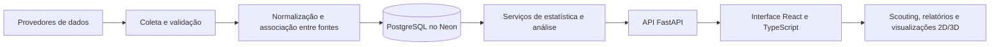

<div align="center">


# ScoutVision

**Do dado à inteligência esportiva.**

Plataforma de scouting e análise exploratória de futebol, com dados de cinco ligas
europeias, relatórios estatísticos e visualizações táticas em 2D e 3D.

[Funcionalidades](#funcionalidades) · [Arquitetura](#arquitetura) ·
[Banco de dados](#banco-de-dados) · [Como executar](#como-executar) ·
[Coleta de dados](#coleta-de-dados) · [Perguntas frequentes](#perguntas-frequentes)

</div>

---

## Sobre o projeto

O ScoutVision organiza dados de futebol de diferentes provedores para apoiar a
exploração de partidas, times e jogadores. O foco são cinco ligas nacionais:

- Premier League (`PL`);
- La Liga (`PD`);
- Bundesliga (`BL1`);
- Serie A (`SA`);
- Ligue 1 (`FL1`).

A plataforma reúne calendário, resultados, elencos, classificações, estatísticas
e, quando disponíveis na fonte, eventos de partida, chutes, coordenadas e gols
esperados (`xG`). Os dados são apresentados em páginas de scouting, relatórios
pré e pós-jogo, comparações e visualizações táticas.

### Transparência sobre os dados

Nem todo número exibido tem a mesma origem. O sistema distingue:

1. **Dados recebidos de provedores**, como placares, chutes, coordenadas e `xG`;
2. **Métricas calculadas pelo ScoutVision**, como taxas por 90 minutos, índices,
   comparações e estimativas probabilísticas;
3. **Informações estimadas**, como uma escalação provável quando não há uma
   escalação confirmada;
4. **Dados de demonstração ou elementos visuais simulados**, usados apenas onde
   identificados como demonstração.

Uma estimativa não é um dado oficial. A cobertura e a atualização dependem dos
provedores; interrupções, mudanças e bloqueios externos podem atrasar uma coleta.
Consulte a página **Sobre e como usar** e `GET /api/data/status` para verificar o
estado informado pelo sistema. Ausência de aviso de atraso não comprova que todo
campo esteja completo.

---

## Funcionalidades

### Partidas e ScoutVision Studio

- Calendário, resultados e detalhes das partidas;
- visualização de chutes, gols, coordenadas e `xG` quando a fonte oferece esses
  dados;
- mapas de calor e mapas por zonas;
- replay tático em 2D e 3D;
- modo de forma recente para jogos sem eventos próprios, quando há amostra
  histórica disponível;
- estado vazio quando não há dados suficientes.

O replay e os elementos visuais não devem ser interpretados automaticamente
como um rastreamento completo de todos os jogadores. A qualidade e o nível de
detalhe dependem dos dados de eventos disponíveis para cada partida.

### Relatórios pré e pós-jogo

O relatório pré-jogo cruza estatísticas anteriores à partida, forma recente,
confrontos e informações de ataque e defesa. Pode apresentar estimativas de
gols, finalizações, probabilidades e cenários de sensibilidade, acompanhadas
dos fatores utilizados.

O relatório pós-jogo compara algumas leituras prévias com o resultado e os
eventos observados. A cobertura varia conforme os dados coletados.

**As probabilidades são estimativas estatísticas, não previsões garantidas,
aconselhamento de aposta ou certeza sobre o resultado.**

### Times

- Estatísticas por temporada e partidas;
- métricas de ataque e defesa, como `xG/90` e `xGA/90`, quando disponíveis;
- forma recente e análise por zonas;
- comparação de times;
- escalações e estatísticas defensivas de partida quando uma fonte compatível
  as fornece.

### Jogadores

- Perfil, clube, posição e estatísticas de temporada;
- métricas por 90 minutos e zonas de finalização, quando há dados;
- índices de scouting por função;
- comparações e busca de perfis semelhantes;
- escalação provável sinalizada como estimada quando não há escalação oficial.

Os índices de 0 a 100 são indicadores relativos. O sistema pode usar percentis
entre jogadores comparáveis quando há amostra suficiente e referências
predefinidas quando ela é pequena. Um índice não é uma nota oficial nem uma
medida absoluta de habilidade.

---

## Arquitetura



### Tecnologias

| Camada | Tecnologias | Responsabilidade |
|---|---|---|
| Interface | React, TypeScript, Vite, Tailwind CSS | Páginas, filtros e visualizações |
| Gráficos e 3D | Recharts, Three.js, React Three Fiber e Drei | Gráficos, campos e replay visual |
| API | Python, FastAPI, Pydantic e Uvicorn | Rotas, validação e lógica de aplicação |
| Dados e análise | SQLAlchemy, NumPy e clientes dos provedores | Acesso ao banco, coleta e cálculos |
| Banco de dados | PostgreSQL, hospedado no Neon | Persistência relacional dos dados |
| Migrações | Alembic | Evolução versionada do esquema |
| Automação e hospedagem | GitHub Actions, Docker e Vercel | Testes, coletas agendadas e publicação |

### Por que usamos mais de uma linguagem?

Cada linguagem atende a uma parte diferente do sistema:

- **Python** é usado na API, nos coletores e nos cálculos estatísticos;
- **TypeScript** é usado na interface web. Seus tipos ajudam a detectar
  inconsistências entre os dados recebidos pela API e o que a tela espera;
- **SQL** é a linguagem de consulta do PostgreSQL. O SQLAlchemy gera e executa
  consultas a partir do código Python, mas o banco continua sendo relacional;
- **HTML e CSS** descrevem a estrutura e a apresentação visual da interface;
- **YAML** configura automações do GitHub Actions e serviços de infraestrutura.

Não são várias tecnologias fazendo a mesma coisa: são ferramentas diferentes
para interface, regras de negócio, armazenamento e automação.

---

## Banco de dados

O ScoutVision usa PostgreSQL com tabelas relacionadas por chaves primárias e
estrangeiras. Entre as entidades principais estão:

```text
competição 1 ── N temporada 1 ── N partida
time       1 ── N partida (mandante ou visitante)
time       1 ── N jogador
partida    1 ── N evento
evento     1 ── 0..1 chute, passe, gol ou outro detalhe
jogador    1 ── N estatística por temporada ou partida
```

Os nomes das tabelas e as relações exatas são definidos nos modelos em
`backend/app/db/models.py` e nas migrações em `backend/alembic/versions/`.

### Por que normalizar o banco?

Na modelagem relacional, cada tipo de entidade fica registrado em seu lugar e é
referenciado por identificadores. Uma partida guarda, por exemplo, os
identificadores da temporada e dos times, em vez de copiar todos os dados desses
times em cada linha da partida.

Isso ajuda a:

- evitar cópias divergentes de nomes e dados dos mesmos times;
- garantir que as relações apontem para entidades existentes;
- atualizar um dado cadastral em um lugar só;
- consultar e combinar partidas, jogadores, eventos e estatísticas com `JOIN`;
- aplicar restrições e índices para consistência e desempenho.

### Por que várias fontes podem ter o mesmo time ou partida?

Cada provedor tem seus próprios identificadores e nomes. O ScoutVision mantém a
origem de cada registro e aplica rotinas de associação para reconhecer times,
jogadores e partidas equivalentes entre provedores. Isso permite preservar a
procedência dos dados sem exigir que todos os provedores usem o mesmo código.

Uma partida equivalente pode ser ligada a um registro canônico para as telas
evitarem duplicatas. Essa associação não significa que todos os dados brutos
foram fundidos ou que uma fonte passou a ser a fonte oficial da outra.

### PostgreSQL e Neon

PostgreSQL é o sistema de banco de dados. Neon é o serviço gerenciado que hospeda
uma instância PostgreSQL na nuvem; não é uma linguagem nem um modelo de banco
diferente. A aplicação conecta-se usando `DATABASE_URL`, mantida em variável de
ambiente e nunca no código-fonte.

---

## Fontes de dados

| Fonte | Uso no projeto | Limitações importantes |
|---|---|---|
| [football-data.org](https://www.football-data.org/) | Calendário, resultados, competições, times, elencos e classificações | Cobertura e limites dependem do plano e do provedor; requer token |
| Understat | Chutes, coordenadas, `xG` e estatísticas relacionadas nas ligas cobertas | A estrutura e a disponibilidade podem mudar; coletas podem falhar ou ficar desatualizadas |
| ESPN | Associação de partidas e estatísticas de partidas disponíveis nos endpoints públicos | Endpoints e cobertura não são uma API contratual do projeto |
| SoccerData / FBref | Dados complementares de temporada e partidas, usados em coletas ou fallback | Pode sofrer restrição, CAPTCHA, mudança de página ou bloqueio |
| StatsBomb Open Data | Eventos históricos de competições e partidas disponíveis publicamente | Catálogo limitado; verificar licença e atribuição antes de redistribuir |

Nem toda fonte preenche todas as ligas, temporadas ou campos. O status das
coletas pode ser consultado em `GET /api/data/status`. Uma coleta marcada como
sucesso informa que a rotina terminou; não garante cobertura completa de cada
campo.

---

## Estatística e estimativas

Os cálculos do projeto incluem, conforme a funcionalidade:

- distribuições de Poisson para contagens;
- distribuição binomial negativa quando a contagem apresenta dispersão maior
  que a média;
- suavização bayesiana para reduzir instabilidade em amostras pequenas;
- percentis e escores padronizados para comparação;
- médias ponderadas para resumir tendências recentes;
- análise de sensibilidade com cenários alternativos.

Alguns endpoints de probabilidade também usam um modelo-base com coeficientes
predefinidos, e não um modelo treinado automaticamente. Isso não deve ser
descrito como inteligência artificial treinada nem como desempenho validado em
temporadas futuras. O projeto não apresenta, neste README, uma taxa de acerto
comprovada em partidas reais.

O `xG` é uma estimativa de qualidade da chance fornecida ou calculada pela fonte
que o reporta. Ele não é uma garantia de que o gol aconteceria, nem é calculado
necessariamente pelo ScoutVision.

---

## Como executar

### Requisitos

- Python 3.11 ou superior;
- Node.js 20 ou superior;
- uma conexão PostgreSQL, por exemplo, um banco no Neon;
- Docker Desktop, se optar por executar com Docker.

### Configuração

Na raiz do repositório, copie `.env.example` para `.env` e preencha as variáveis
necessárias. No PowerShell:

```powershell
Copy-Item .env.example .env
```

Em macOS, Linux ou Git Bash:

```bash
cp .env.example .env
```

Configure pelo menos:

| Variável | Finalidade |
|---|---|
| `DATABASE_URL` | URL de conexão PostgreSQL; use a string de conexão do Neon, não a URL de uma Data API |
| `FOOTBALL_DATA_TOKEN` | Token de acesso do football-data.org para executar essa coleta |
| `CORS_ORIGINS` | Origens autorizadas a acessar a API |
| `VITE_API_BASE_URL` | Endereço da API para desenvolvimento local |

Há outras opções no `.env.example`. Não compartilhe o `.env`, não o envie ao Git
e não cole credenciais em issues, slides ou conversas.

### Execução local

Terminal 1 — backend:

```powershell
Set-Location backend
python -m venv .venv
.\.venv\Scripts\Activate.ps1
pip install -r requirements-dev.txt
python -m alembic upgrade head
uvicorn app.main:app --reload --host 127.0.0.1 --port 8000
```

Terminal 2 — frontend:

```powershell
Set-Location frontend
npm ci
npm run dev
```

Endereços locais:

| Serviço | Endereço |
|---|---|
| Interface | `http://localhost:5173` |
| API | `http://localhost:8000/api` |
| Documentação interativa | `http://localhost:8000/docs` |
| Verificação de saúde | `http://localhost:8000/api/health` |

Os comandos de ativação do ambiente virtual variam por sistema operacional.
Em macOS/Linux, use `source .venv/bin/activate`.

### Execução com Docker

Configure o `.env` e execute, na raiz:

```bash
docker compose up --build
```

Esse comando sobe a interface e a API; o banco continua sendo o PostgreSQL
configurado em `DATABASE_URL`. Para ativar também o coletor local recorrente:

```bash
docker compose --profile local-collector up --build
```

Use o coletor local **ou** o agendamento do GitHub Actions para o mesmo fluxo,
não ambos ao mesmo tempo, a menos que tenha coordenado as execuções.

---

## Coleta de dados

Os coletores ficam em `backend/app/services/`. Sempre confira o status retornado
e as regras atuais dos provedores antes de executar uma sincronização.

### football-data.org

```powershell
Set-Location backend
python -m alembic upgrade head
python -m app.services.data_sync --competitions PL
```

Requer `FOOTBALL_DATA_TOKEN` e `DATABASE_URL`. A lista de competições pode ser
configurada conforme os valores aceitos pelo coletor.

### Understat

```powershell
Set-Location backend
python -m app.services.understat_sync --leagues epl --season 2026
python -m app.services.understat_sync --fast --leagues all
```

A coleta depende da disponibilidade e do formato atual da fonte. Se a fonte
responder com erro ou mudar sua página, a sincronização pode falhar; consulte
`/api/data/status` em vez de assumir que os dados estão atualizados.

### SoccerData / FBref

```powershell
Set-Location backend
python -m app.services.soccerdata_sync --leagues PL PD BL1 SA FL1 --season 2026-27
python -m app.services.soccerdata_sync --probe
```

O acesso pode ser limitado pelo provedor. Respeite seus termos e limites de
requisição; não tente contornar bloqueios ou CAPTCHA.

### ESPN e StatsBomb

Os coletores e parâmetros de importação estão documentados nos módulos
`backend/app/services/espn_sync.py` e
`backend/app/services/statsbomb_importer.py`. Consulte o `--help` de cada
módulo antes de executar. Dados StatsBomb estão sujeitos à licença e às regras
de atribuição do projeto de dados abertos.

### Agendamento

Os arquivos de automação estão em `.github/workflows/`. Configure os segredos
necessários no GitHub Actions, especialmente `DATABASE_URL` e, para o
football-data.org, `FOOTBALL_DATA_TOKEN`. O histórico de execuções indica se a
rotina terminou; o endpoint de status mostra o checkpoint mais recente conhecido
pela aplicação.

---

## API

A API usa o prefixo `/api`. A documentação interativa do ambiente em execução
está em `/docs` e `/redoc`.

Rotas mais usadas:

| Recurso | Rotas |
|---|---|
| Sistema | `/api/health`, `/api/stats/counts`, `/api/data/status` |
| Competições e temporadas | `/api/competitions`, `/api/seasons` |
| Times | `/api/teams` e `/api/teams/{id}` |
| Jogadores | `/api/players` e `/api/players/{id}` |
| Partidas | `/api/matches` e `/api/matches/{id}` |
| Análise | `/api/matches/{id}/analysis`, `/insights`, `/report` |
| Comparação | `/api/compare/...` |

Os parâmetros e sub-recursos podem mudar; use `/docs` como referência atual.

---

## Testes e verificações

Backend:

```powershell
Set-Location backend
pytest
```

Frontend:

```powershell
Set-Location frontend
npm run lint
npm run typecheck
npm run build
```

As verificações devem ser executadas antes de publicar alterações. Um build
bem-sucedido não substitui testes de integração com cada provedor ou uma
avaliação estatística das probabilidades.

---

## Estrutura do repositório

```text
scout/
├── backend/
│   ├── app/
│   │   ├── api/             Rotas da API
│   │   ├── db/              Modelos e acesso ao banco
│   │   ├── services/        Coletores e serviços de análise
│   │   ├── ml/              Recursos de probabilidade e modelos-base
│   │   └── vendor/          Cliente de provedor mantido no projeto
│   ├── alembic/versions/    Migrações do banco
│   └── tests/               Testes automatizados
├── frontend/
│   ├── public/              Imagens, modelos e recursos visuais
│   └── src/
│       ├── api/             Cliente e conversores de dados
│       ├── components/      Componentes e visualizações
│       └── pages/           Páginas da aplicação
├── .github/workflows/       Testes e coletas agendadas
├── docker-compose.yml
└── vercel.json
```

---

## Perguntas frequentes

### O ScoutVision prevê o resultado de uma partida?

Ele calcula estimativas a partir das informações disponíveis e apresenta os
fatores usados. Uma estimativa probabilística não determina o resultado real e
não deve ser tratada como certeza.

### O sistema usa inteligência artificial treinada?

Não se deve afirmar isso para os recursos descritos aqui. O projeto usa métodos
estatísticos e, em algumas probabilidades, coeficientes predefinidos. Isso é
diferente de treinar e validar um modelo de aprendizado de máquina em uma base
histórica. Não há uma métrica de acerto em partidas reais documentada neste
README.

### Por que usar PostgreSQL em vez de guardar tudo em planilhas ou arquivos?

O sistema relaciona muitas partidas, times, jogadores, temporadas e eventos.
PostgreSQL permite impor integridade referencial, consultar relações, filtrar e
ordenar dados e criar índices para as consultas usadas pela aplicação.

### Por que o banco é normalizado?

Porque informações de entidades são mantidas em registros próprios e ligadas por
chaves. Isso reduz duplicação e inconsistência, preserva a origem dos registros
e facilita combinar dados de partida, elenco e temporada. Campos flexíveis de
provedores podem ser mantidos em estruturas JSON quando não se encaixam em
colunas comuns.

### Por que os nomes e identificadores variam entre provedores?

Cada serviço define seus próprios identificadores e grafias. O ScoutVision usa
rotinas de associação para ligar registros equivalentes sem descartar a
procedência de cada fonte. Uma associação pode não ser possível ou exigir
revisão se os dados forem ambíguos.

### Escalação provável significa escalação oficial?

Não. Uma escalação oficial vem de um dado confirmado da fonte. Uma escalação
provável é uma estimativa e deve aparecer identificada como tal.

### Todos os dados são atualizados em tempo real?

Não. Os dados dependem de coletas periódicas, da cobertura de cada fonte e da
disponibilidade externa. Confira a última execução em `/api/data/status`.

### Os números de uma apresentação são dados reais?

Somente se forem extraídos de uma consulta identificada, com fonte, período e
definição do indicador. Exemplos sem essa origem devem ser marcados
explicitamente como fictícios e não podem ser apresentados como resultados do
ScoutVision.

---

## Licenças e atribuições

- O ScoutVision não é uma fonte oficial de ligas, clubes ou estatísticas.
- Antes de redistribuir dados StatsBomb Open Data, siga a licença e as regras de
  atribuição publicadas pelo projeto.
- O acesso a football-data.org, Understat, ESPN e FBref depende da
  disponibilidade, cobertura e termos aplicáveis de cada provedor.
- Dados sintéticos ou demonstrações devem ser identificados como tais.

<div align="center">

Feito para transformar dados de futebol em contexto — com limites e fontes à vista.

</div>
