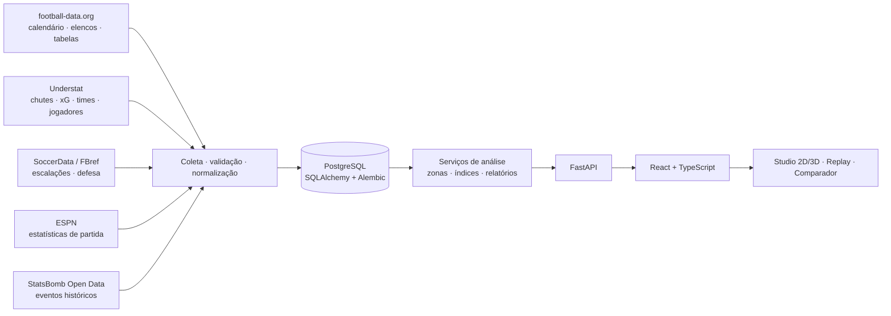

<div align="center">


# ScoutVision

**Plataforma de scouting e análise exploratória de futebol — das 5 grandes ligas europeias.**
Dados reais de várias fontes, índices por função, relatórios pré e pós-jogo e um estúdio tático 2D/3D com replay de lances.


[Funcionalidades](#-funcionalidades) · [Arquitetura](#-arquitetura) · [Início rápido](#-início-rápido) · [Coleta de dados](#-coleta-de-dados) · [API](#-api) · [Princípios](#-princípios-do-projeto)

</div>

---

## O que é

O ScoutVision reúne calendário, resultados, clubes, elencos, classificações, **chutes com coordenadas e xG** e estatísticas de jogadores das cinco grandes ligas — **Premier League (PL), La Liga (PD), Bundesliga (BL1), Serie A (SA) e Ligue 1 (FL1)** — e transforma tudo em respostas de decisão: onde cada defesa é frágil, quem deve finalizar mais, quais jogadores se parecem entre si e o que os números dizem sobre um confronto.

> **Transparência acima de tudo.** Nenhuma estatística é inventada. Quando a fonte não traz um dado, o campo fica vazio e a tela mostra “—”. Tudo o que é calculado usa **estatística descritiva e probabilística transparente** (Poisson, binomial negativa, suavização bayesiana, percentis) — nada de caixa-preta. As probabilidades são estimativas, nunca certezas.

---

##  Funcionalidades

###  ScoutVision Studio — análise visual de partidas

O coração da tela **Análise**. Para cada partida, o Studio desenha apenas o que existe no banco:

- **Mapa de calor profissional** — estimativa de densidade por kernel (KDE gaussiano) calculada **em metros** (campo FIFA 105 × 68), ponderada por xG, sobre gramado com faixas de corte.
- **Chutes, chutes no alvo e gols** com coordenadas reais, xG, situação de jogo (bola rolando, escanteio, falta, pênalti…), parte do corpo e resultado.
- **Linha do tempo de xG acumulado** por time, com marcadores nos gols, e **dispersão xG × gols**.
- **Escalação em campo** com camisas dos clubes (marcadores estilo SofaScore), posições e fichas de jogador com abas de **finalização, passes, dribles e defesa**.
- **Replay de lances em 2D e em 3D**, com barra de progresso e modo livre.
- **Três modos de dado**, sempre sinalizados na tela:
  | Modo | Quando aparece |
  |---|---|
  | `match` | A própria partida (ou a “gêmea” em outra fonte) tem chutes |
  | `recent_form` | Partida futura: agrega os chutes dos últimos jogos de cada time |
  | `none` | Nenhuma fonte tem chutes — a tela mostra o estado vazio, sem fabricar nada |

###  Replay 3D realista

Cena estilo transmissão, carregada sob demanda (React Three Fiber + Drei):

- **Estádio 3D** com arquibancada, torcida (`crowd_seats`) e textura de bola.
- **Jogadores animados** com cerca de **60 clipes** de movimento: corrida, trote em várias direções, chute, pênalti, voleio/bicicleta, cabeceio, carrinho, domínio, comemoração e lamento.
- **Goleiros com animações próprias**: mergulho, espalmada, encaixe, saída de bola, reposição com as mãos e com os pés.
- **Sincronia pé–bola**: o replay mede o instante exato de contato de cada clipe (`tools/measure_clips.py` → `clipCatalog.ts`) para a bola só sair depois que o pé encosta, e o alcance das luvas do goleiro acompanha a trajetória do chute.
- **Uniformes reais** dos clubes (`kits.ts`, `teamKits.ts`) aplicados com máscara de camisa.
- Fator de câmera/tempo diferente para escanteios e faltas.

###  Relatório pré-jogo

Transforma as estatísticas em respostas de decisão, cada uma com os números que a justificam:

1. **Principais fragilidades defensivas** de cada time.
2. **Quem concede mais finalizações?**
3. **Por qual lado do campo** cada ataque encontra mais oportunidades.
4. **Jogadores com maior participação ofensiva** (oportunidade = √(ataque × fraqueza da defesa adversária)).
5. **Tendências do confronto** — forma recente × temporada e confrontos diretos.
6. **Fatores que favorecem cada equipe**.
7. **Estimativa estatística** de gols, 1×2, Mais de 2,5 e Ambos marcam (sem placar exato) e de finalizações, com **análise de sensibilidade** em três cenários (favorável / base / conservador).
8. **Conclusão fundamentada.**

Só usa jogos **anteriores** à partida — sem vazamento do resultado.

###  Relatório pós-jogo

Compara o que o relatório pré-jogo esperava com o que realmente aconteceu: cada leitura recebe **Acertou ✓ / Errou ✗ / Sem dados –**, agrupada em *Resultado, Gols, Finalizações, Campo e Jogadores*, com um resumo “o que deu certo / o que errou” que pode ser copiado como texto.

###  Análise de zonas (defesa × ataque)

- **Fraqueza defensiva por zona**: xG concedido nos últimos jogos comparado à média da liga na mesma temporada (0,5 = na média; 1,0 = o dobro).
- **Força ofensiva por zona** e “oportunidades” por jogador.
- Mapa **2D e 3D clicáveis**; ao clicar numa zona, o painel mostra as estatísticas de cada time naquela região.
- Considera o **goleiro titular** do time nas zonas defensivas.

###  Perfil do jogador

- Cartões de **Gols, Assistências, xG e xA por 90 min**.
- **Índice ofensivo ScoutVision** em cinco componentes — *Finalização, Criação, Produção, Construção e Regularidade* — com pesos por função.
- **Índice defensivo** (defensores) e **índice de goleiro**, com notas **0–100 por percentil** entre pares da mesma função, liga e temporada.
- Zonas de finalização derivadas dos chutes reais, **forma recente** (últimos jogos com gols, assistências, chutes e xG) e próximo jogo.
- **Probabilidades por jogador**: 1+ chute, 1+ chute no alvo, gol e participação em gol, ajustadas pela fraqueza da defesa adversária.

###  Comparador

- **Jogador × jogador** com os mesmos índices da tela do jogador, escolhendo a temporada. Só compara jogadores da **mesma família** (ofensivo, defensor, goleiro).
- **Gráfico polar 2D e 3D** e “líder” de cada componente.
- **Substitutos semelhantes**: busca por similaridade de perfil entre as notas dos componentes, com filtros.
- **Comparador de goleiros** e **comparador de times**.

###  Times, ligas e painel

- **Página do time**: pontos por jogo, **ataque (xG/90)**, **defesa (xGA/90)**, gráfico de forma jogo a jogo, ranking de fraquezas, elenco com J · G · xG e mapa de zonas.
- **Defesa coletiva e goleiros** (ESPN + derivadas): chutes enfrentados, defesas, gols sofridos, com amostra e fonte visíveis.
- **Ligas**: tabelas completas, **artilheiros, Top xG e mais chutes**, cobertura Understat e botão **“Sincronizar agora”**.
- **Painel**: partida em destaque, chutes por zona, próximas partidas, resultados recentes e principais times.
- **Sobre e como usar**: contagens do banco e **status de cada coleta** com aviso de dados possivelmente desatualizados.

###  Inteligência “por baixo do capô”

| Recurso | O que faz |
|---|---|
| **Estatísticas derivadas** (`derived_stats`) | Após a Opta encerrar o contrato com o FBref (jan/2026), o site retirou as estatísticas avançadas. O ScoutVision **deriva** nota de goleiro e de defensor a partir de chutes do Understat, escalações/minutos e placar: defesas, `xGOT − GA` (gols evitados, aproximação do PSxG), clean sheets e o que o time sofreu enquanto o jogador estava em campo. |
| **Deduplicação de jogadores** | “Gabriel” × “Gabriel Magalhães” entre fontes viram uma só pessoa **na leitura** (nada é apagado do banco). |
| **Reconciliação de partidas** | Liga a mesma partida entre fontes (partida “gêmea”) por competição, times, data e placar. |
| **Escalação oficial × estimada** | `official` quando há escalação gravada; `estimated` monta um provável XI pelo elenco e minutos — sempre declarado em `source`. |
| **Backfill de posições** | Preenche a posição de jogadores sem “tipo” usando Understat → escalações → evidência de goleiro, sem sobrescrever e de forma idempotente. |
| **Escudos** | Catálogo de escudos para times sem logo (ex.: seleções do StatsBomb); sem entrada, o front mostra iniciais. |
| **Normalização de nomes** | Resolve grafias diferentes entre fontes (“Arsenal” × “Arsenal FC”, “Paris FC” × “PSG”). |

###   Matemática estatística (`stats_math.py`)

Puro Python, determinístico e testável isoladamente:

- **Poisson** e **binomial negativa** (para contagens “irregulares”, como chutes e escanteios, com dispersão por método dos momentos);
- **Suavização bayesiana** (gama-Poisson / beta-binomial) para amostras pequenas;
- **Cadeia de probabilidades**: gols = chutes × P(no alvo | chute) × P(gol | no alvo);
- **Percentil, Z-score e Z robusto (MAD)**;
- **Média móvel ponderada** e tendência recente × temporada;
- **Matriz de placares**, 1×2, Over 2,5, Ambos marcam e faixas 10–90%;
- **Similaridade de perfis** e **análise de sensibilidade**.

---

## Arquitetura



### Stack

| Camada | Tecnologias |
|---|---|
| **Frontend** | React 18, TypeScript, Vite, Tailwind CSS, TanStack Query, Zustand, Axios, Recharts, Three.js, React Three Fiber, Drei |
| **Backend** | Python 3.11, FastAPI, Uvicorn, Pydantic v2, SQLAlchemy 2.0, Alembic, HTTPX, aiohttp |
| **Dados** | NumPy (cálculos em runtime), SoccerData, cliente Understat embutido (`app/vendor`) |
| **Banco** | PostgreSQL 15+ (Neon), 10 migrações Alembic |
| **Infra** | Docker, Docker Compose, GitHub Actions, Vercel (Services) |

### Fontes de dados

| Fonte | O que fornece | Observações |
|---|---|---|
| **football-data.org** | Calendário, resultados, clubes, elencos e classificações | Token gratuito; sem xG nem eventos |
| **Understat** | xG, xGA, chutes com coordenadas, gols e assistências, tabela com PPDA/deep | Principal fonte de eventos das 5 ligas |
| **SoccerData / FBref** | Escalações oficiais, assistências e ações defensivas por partida | Manual; respeite cache e limites do site |
| **ESPN** | Escalações, estatísticas de ataque/goleiro e defesa coletiva | Endpoints públicos, sem chave |
| **StatsBomb Open Data** | Eventos históricos de competições selecionadas | Catálogo limitado; importação manual |

---

## 🚀 Início rápido

### Docker Compose (recomendado)

```bash
# 1. Copie o arquivo de ambiente
cp .env.example .env          # Windows: copy .env.example .env

# 2. Preencha DATABASE_URL (Neon) e FOOTBALL_DATA_TOKEN no .env
#    Não há container de PostgreSQL local: o banco é o Neon.

# 3. Suba backend, frontend e o coletor recorrente
docker compose --profile local-collector up --build
```

| Serviço | URL |
|---|---|
| Frontend | http://localhost:5173 |
| Backend | http://localhost:8000 |
| Swagger / ReDoc | http://localhost:8000/docs · http://localhost:8000/redoc |

As migrações rodam automaticamente na inicialização do backend. Dados de demonstração **não** são carregados sozinhos.

### Desenvolvimento local (sem Docker)

**Requisitos:** Python 3.11+, Node.js 20+ e uma connection string PostgreSQL (Neon) no `.env` da raiz.

```bash
# Backend
cd backend
python -m venv venv
source venv/bin/activate        # Windows: venv\Scripts\activate
pip install -r requirements-dev.txt
alembic upgrade head
uvicorn app.main:app --reload --host 0.0.0.0 --port 8000
```

```bash
# Frontend
cd frontend
npm install
npm run dev
```

### Variáveis de ambiente

| Variável | Descrição |
|---|---|
| `DATABASE_URL` | Conexão PostgreSQL do Neon (`postgresql://` ou `postgresql+psycopg://`, com `sslmode=require`). **Nunca** use a URL https da Data API |
| `FOOTBALL_DATA_TOKEN` | Token gratuito em [football-data.org](https://www.football-data.org/client/register) |
| `SYNC_COMPETITIONS` | Competições coletadas (padrão: `PL,PD,BL1,SA,FL1`) |
| `SYNC_INTERVAL_HOURS` | Intervalo do coletor local (padrão: `12`) |
| `SECRET_KEY` | Segredo JWT — use um valor longo e aleatório em produção |
| `CORS_ORIGINS` | Origens permitidas pelo backend |
| `VITE_API_BASE_URL` | URL da API usada pelo frontend em desenvolvimento |
| `JWT_ALGORITHM` · `ACCESS_TOKEN_EXPIRE_MINUTES` | Configuração de tokens administrativos |


---

##  Coleta de dados

Todas as rotinas são **idempotentes**, preservam valores não vazios de outras fontes e registram checkpoints em `collection_state`. Nada é criado “do nada”: os complementares só **ligam** dados a partidas, times e jogadores que já existem.

### football-data.org — calendário, times e tabelas

```bash
cd backend
python -m alembic upgrade head
python -m app.services.data_sync --competitions PL
```

Valida, normaliza e faz *upsert* transacional de times, elencos, partidas e classificações, sem duplicar IDs do provedor. Usa *advisory lock* no banco para evitar gravações concorrentes.

### Understat — chutes, xG e estatísticas

```bash
python -m app.services.understat_sync --leagues epl --season 2026
python -m app.services.understat_sync --fast --leagues all   # modo rápido
```

O **modo rápido** baixa só as partidas que faltam, **das mais recentes para as antigas**, em paralelo (concorrência configurável). É a mesma lógica do botão **“Sincronizar agora”** da tela Ligas (`POST /api/understat/sync/fast`).

### SoccerData / FBref — escalações e defesa

```bash
python -m app.services.soccerdata_sync --leagues PL PD BL1 SA FL1 --season 2026-27
python -m app.services.soccerdata_sync --leagues PL PD BL1 SA FL1 --season 2026-27 --season-only
python -m app.services.soccerdata_sync --probe   # verifica a disponibilidade
```

`--season-only` evita baixar cada relatório de partida e importa só os totais da temporada (`misc`, `keeper`, `shooting`). FBref **não** fornece xG por chute.

### ESPN — estatísticas de partida

```bash
python -m app.services.espn_sync --leagues PL PD BL1 SA FL1 --season 2026-27
```

Sem chave de API, com cache em `~/.scoutvision/espn-cache` e commits em lotes retomáveis. Fixtures sem correspondência ficam explícitas no checkpoint.

### StatsBomb Open Data — eventos históricos

```bash
python -m app.services.statsbomb_importer --competition 43 --season 106 --match-ids 3869685
```

Importa JSONs selecionados (sem clonar o repositório), pula partidas inalteradas e normaliza coordenadas de 120×80 para 100×100 relativas ao time atacante. Limite de **5 partidas por execução** e *guard* de 400 MiB no banco. **Consulte a licença e a atribuição do StatsBomb antes de publicar.**

### Rotinas de manutenção

```bash
python -m app.services.derived_stats                 # estatísticas derivadas de goleiro/defesa
python -m app.services.backfill_positions --dry-run  # preenche posições (tire --dry-run para aplicar)
python -m app.services.purge_competition --dry-run   # remove competições fora do escopo
python -m app.seed_demo                              # dados sintéticos de demonstração (opcional)
```

### Agendamento automático (GitHub Actions)

| Workflow | Frequência | O que faz |
|---|---|---|
| `ci.yml` | A cada push / PR | Testes do backend (pytest), lint, typecheck e build do frontend |
| `data-sync.yml` | 06:23 e 18:23 UTC | football-data.org → Neon, e remoção de competições descartadas |
| `understat-sync.yml` | A cada 3 horas | Understat em modo rápido, com **fallback FBref** (`--season-only`) se falhar |

Configure os *secrets* `DATABASE_URL` e `FOOTBALL_DATA_TOKEN` e, opcionalmente, as variáveis `SYNC_COMPETITIONS` e `UNDERSTAT_LEAGUES`.

> **Use o workflow *ou* o perfil `local-collector`, não os dois contra o mesmo banco**, para evitar chamadas duplicadas e consumo da cota do provedor. O coletor local sincroniza imediatamente, repete a cada 12 h e tenta de novo em até 15 min após uma falha. `/api/data/status` mostra a última coleta e indica dados atrasados.

---

##  API

Documentação interativa em `/docs` (Swagger) e `/redoc`.

| Grupo | Endpoints principais |
|---|---|
| **Meta** | `GET /health` · `/api/stats/counts` · `/api/data/status` |
| **Competições** | `GET /api/competitions` · `/api/seasons` · `/api/seasons/{id}/standings` |
| **Times** | `GET /api/teams` · `/api/teams/{id}` · `/statistics` · `/weaknesses` · `/defensive-stats` · `/api/crests` |
| **Jogadores** | `GET /api/players` · `/{id}` · `/overview` · `/index` · `/statistics` · `/zones` · `/shot-probability` · `/goal-probability` · `/api/similar` |
| **Partidas** | `GET /api/matches` · `/{id}` · `/analysis` · `/predictions` · `/insights` · `/report` · `/zones` · `/lineups` · `/studio` · `/tactical-analysis` |
| **Comparação** | `GET /api/compare/...` |
| **Understat** | `GET /api/understat/leagues` · `/matches` · `/stats` · `/league-table/{liga}` · `/teams/{id}/profile` · `/form` · `/shots` · `/players/{id}/shots` · `POST /sync` · `/sync/fast` |
| **Modelos** | `GET /api/models` · `POST /api/predictions/generate` |

`GET /api/understat/teams/{team_id}/profile` aceita o id de um time de **qualquer fonte** e procura os chutes reais nos times equivalentes (mesmo nome normalizado), devolvendo resumo da temporada, jogo a jogo, fraqueza defensiva e força ofensiva por zona e jogadores ligados ao elenco.

---

##  Deploy na Vercel

O `vercel.json` publica `frontend/` (Vite) e `backend/` (FastAPI) como **dois serviços no mesmo domínio**: `/api/*` vai para o FastAPI e o resto para o frontend.

1. Configure no serviço de backend: `DATABASE_URL`, `SECRET_KEY` e, se quiser dados ao vivo, `FOOTBALL_DATA_TOKEN`.
2. Aplique as migrações uma vez no banco de produção: `python -m alembic upgrade head` (dentro de `backend/`).
3. O frontend usa `/api` automaticamente em produção.

Funções da Vercel não rodam coletores contínuos — use os workflows do GitHub Actions para a coleta agendada.

---

##  Testes e qualidade

```bash
# Backend — mais de 200 testes
cd backend && pytest

# Frontend
cd frontend
npm run lint
npm run typecheck
npm run build
```

Cobertura inclui: API, sincronizações (football-data, Understat, SoccerData, ESPN), matemática estatística, índices por função, comparador, relatórios pré e pós-jogo, escalações, reconciliação de partidas, deduplicação de jogadores, Studio e perfil de times.

---

## 🗂️ Estrutura do projeto

```
scout/
├── backend/
│   ├── app/
│   │   ├── api/            # Rotas FastAPI (partidas, times, jogadores, Understat…)
│   │   ├── services/       # Coletores e análises (studio, match_report, position_index…)
│   │   ├── db/             # Modelos SQLAlchemy
│   │   ├── ml/             # Features e baselines
│   │   └── vendor/         # Cliente Understat embutido
│   ├── alembic/versions/   # 10 migrações
│   └── tests/              # Suíte pytest
├── frontend/
│   ├── public/models/      # Animações .glb, textura de bola, torcida e máscara de camisa
│   └── src/
│       ├── pages/          # Painel, Partidas, Times, Jogadores, Comparar, Análise, Ligas…
│       ├── components/     # Studio, mapas de zona, polar 2D/3D e realism/ (replay 3D)
│       └── lib/            # KDE, geometria do campo, zonas, kits, escudos
├── teste-api/              # Coletor de linha de comando (football-data.org)
├── .github/workflows/      # ci · data-sync · understat-sync
├── docker-compose.yml
└── vercel.json
```

---

## 🧭 Princípios do projeto

1. **Nenhum dado inventado** — o que a fonte não traz fica vazio (“—”).
2. **Sem chamadas externas pelo frontend** — apenas backend e serviços de dados.
3. **Histórico preservado** (bruto + normalizado); eventos originais ficam em `event.details`.
4. **Sem vazamento de dados futuros** — análises de uma partida usam só jogos anteriores a ela.
5. **Estatística transparente** — índices e probabilidades são descritivos e explicáveis, não modelos treinados e validados.
6. **Probabilidades nunca são certezas.**
7. **Demonstração é demonstração** — dados `data_source = demo` e visualizações simuladas são sempre rotulados.
8. **Acesso público** — a interface não tem login; a API mantém proteção JWT nos endpoints administrativos de importação e gestão.

---

## 📄 Licença e atribuições

- Dados derivados do **StatsBomb Open Data** seguem a [licença e as regras de atribuição do StatsBomb](https://github.com/statsbomb/open-data).
- O ScoutVision não é uma fonte oficial de ligas ou clubes; a cobertura depende do que cada provedor publica.
- O SoccerData raspa o FBref: respeite os termos de uso e os limites de requisição do site.
- Os dados de demonstração são sintéticos.

<div align="center">

Feito com ⚽ e muitos chutes de xG.

</div>
